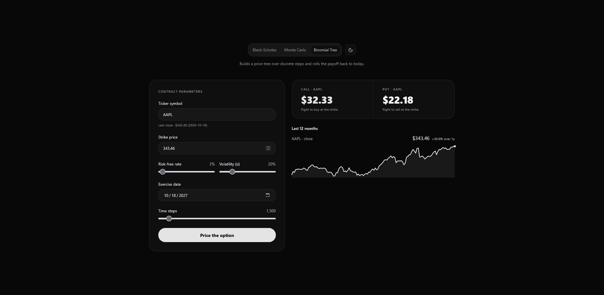

# Option Pricing Models

Compare European option prices three ways — **Black–Scholes**, **Monte Carlo**, and a **binomial tree** — on live Yahoo Finance data, all on one screen.

**[▶ Try it live](https://options-uuuz.vercel.app/)** — click to open the app.



Pick a method in the tabs, set the contract (ticker, strike, risk-free rate, volatility, exercise date — plus simulations and time steps where they apply), and hit **Price the option**. The call/put figures, the ticker's one-year price chart, and — on Monte Carlo — a grid of simulated paths appear *beside* the parameters, no scrolling. The live last close seeds the strike; switching symbols clears it and re-seeds from the new quote. Light and dark themes, scrubbable charts, keyboard access throughout.

> The live site runs the full stack — the React app on the CDN, the FastAPI pricing service on Vercel — so quotes, history, and prices there are the real thing, exactly as when run locally. The only difference: after a quiet period the first request waits a couple of seconds for the function to wake up.

## Quick start

Two processes: the pricing API and the web app.

### 1. Pricing API — Python

The API reuses the engines in `legacy/option_pricing/` untouched (their tests still apply).

```bash
python -m venv .venv
.venv/bin/pip install -r legacy/Requirements.txt -r server/requirements.txt
.venv/bin/pip install yfinance==1.7.0    # the legacy pin (0.2.31) no longer speaks Yahoo's API
npm run api                               # FastAPI on http://localhost:8000
```

On Windows use `.venv\Scripts\pip` instead of `.venv/bin/pip` (`npm run api` already handles its side).

### 2. Web app — Node

```bash
npm install
npm run dev        # Vite on http://localhost:5173
```

Open **http://localhost:5173** — the dev server proxies `/api` to the pricing API.

## Deploy to Vercel

Both halves deploy together: the Vite build is served as static files, and `server/main.py` becomes a single Python function that answers `/api/*` — the same paths, so the client needs no configuration.

| File | Role |
| --- | --- |
| `pyproject.toml` | `[project]` pins Python 3.12 and the dependency set for `uv lock`/`uv sync`; `[tool.vercel]` points Vercel at the ASGI entrypoint `server.main:app` |
| `requirements.txt` | The same dependency set mirrored for pip-based installs (no streamlit, no uvicorn, no matplotlib) |
| `uv.lock` | The resolved lockfile, committed so the build's `uv lock` is a no-op and transitive versions are pinned |
| `vercel.json` | Pins the FastAPI preset, sets the build command (`npm install && npm run build`), and excludes `.venv`/`node_modules`/front-end sources from the function bundle |
| `server/main.py` | `app.frontend("/", directory="dist")` serves the built app for any request that matches no API route; Vercel promotes those files to the CDN at build time |

```bash
npm i -g vercel
vercel            # first run links the project
vercel --prod     # production
```

Or import the repository in the Vercel dashboard — `vercel.json` already pins the framework and build settings.

Notes:

- `pyproject.toml` and `requirements.txt` carry the same pinned dependency set — keep them in sync; `uv` reads the former, pip the latter.
- Don't run `uv sync` in the local `.venv`: it installs exactly the API's set and would strip streamlit/matplotlib that the legacy Streamlit app needs. Vercel syncs its own fresh environment.
- The first request after a cold start pays ~2–4 s to import pandas/scipy/yfinance. The quote (60 s) and history (300 s) caches live per warm instance, so Yahoo gets hit a bit more often than locally.

## API

| Endpoint | Returns |
| --- | --- |
| `GET /api/quote?ticker=AAPL` | Live last close and its date (cached 60s) |
| `GET /api/history?ticker=AAPL` | One year of daily closes, ~90 points, and the % change |
| `GET /api/price?model=black-scholes&ticker=AAPL&strike=343.46&rate=0.1&sigma=0.2&expiry=2027-10-18&sims=10000&steps=1500&paths=100` | Call and put prices from the selected engine; Monte Carlo also returns sampled paths for the chart |

`model` is one of `black-scholes`, `monte-carlo`, `binomial`; `rate` and `sigma` are decimals (0.1 = 10%).

## Project structure

```
src/                     React app (Vite · TypeScript · Tailwind CSS 4)
  components/ui/         tabs, theme switch, sparkline — uiarc registry components
  components/model-switcher/   the pricing desk: parameters, results, charts
  lib/api.ts             typed client for the pricing API
server/                  FastAPI service wrapping the legacy engines
legacy/                  the original Streamlit app (see legacy/README.md)
  option_pricing/        the pricing package: Black–Scholes, Monte Carlo, binomial
docs/preview.png         screenshot used above
```

## Notes

- The three models price the same contract differently on purpose — Monte Carlo within simulation error, the binomial tree within discretization error of the closed form. That comparison is the product.
- Live data comes from Yahoo Finance via `yfinance`; quotes are cached briefly, one-year history for five minutes.
- UI components are from the [uiarc](https://uiarc.dev) registry (tabs, sparkline, theme-switch), animated with [motion](https://motion.dev), built on Radix primitives.
